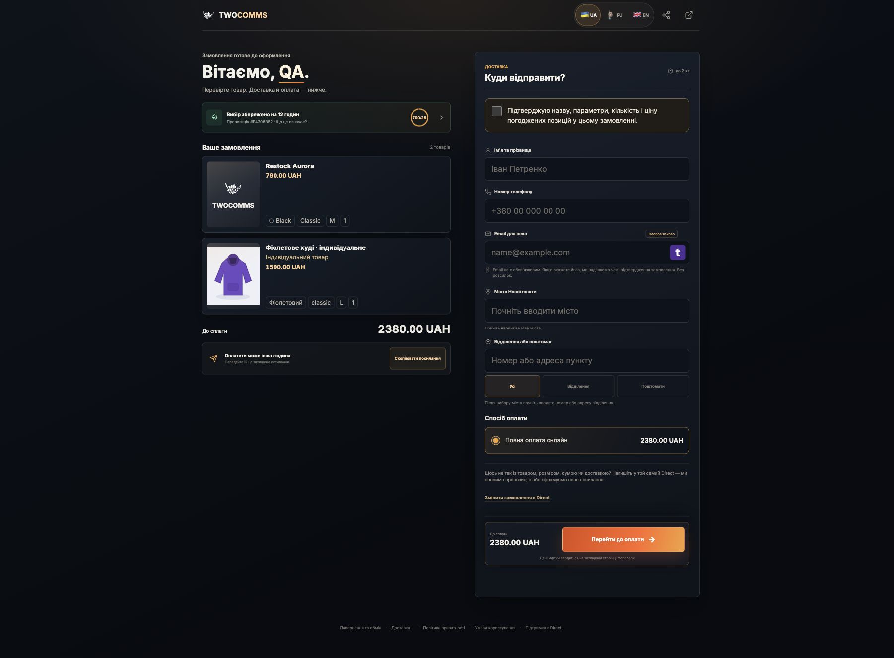

# Engineering39 · кастомный и смешанный checkout · 14.10.2026

✅ Код `7ea9d1f31bf95b915d7b0953158bfe0ded00adf9` выпущен через canonical SSH main/pull. [Production receipt](PRODUCTION_RELEASE_2026-10-14.md). [Контракт](CONTRACT.md).

471 **уникальный** native MariaDB сценарий принят, 0 skips; 29 Node tests PASS, 0 skips; отдельный journey/payment regression script PASS. Django check и migration drift чистые. [Имена сценариев и результаты отдельных прогонов](native-accepted.json), [сводка](VALIDATION.json). Это объединение успешных сценариев с повторными проверками после исправлений, а не один запуск 471 теста. Первый полный прогон выявил ошибки фикстур; их исправили и повторно проверили. Browser QA также нашёл реальный 500 при форматировании строковой цены custom-позиции; native Decimal rendering исправлен и защищён шестью полными UK/RU/EN custom/mixed token-entry→template тестами. Финальные прогоны payment/public-identity/Hosted/history:51/51; legacy upgrade/core/payment:52/52.

Root владел DB, Git, браузером и релизом. Субагенты разделили schema/core, checkout/provenance, generation/winner, API/media, prompt/live, UI и независимую adversarial-проверку; пересекающиеся late fixes согласованы через один shared guard. Production не использовалась как тестовая база. Полная программа27паспортов остаётся частичной; Engineering40–41 OPEN.

## UI acceptance

Локальная изолированная MariaDB: собственный custom-source→реальный manager draft edit названия/цены→private upload→approval→явный физический stock recount каталожной строки→prepare→тот же ordinary proposal workspace→copied token-entry→mixed hosted checkout. Каталог790 UAH + custom1590 UAH =2380 UAH. Фото реально декодировано и связано с draft; затем отображено в менеджерской панели и защищённом checkout. Автоматический Chrome file chooser заблокирован отсутствием Allow access to file URLs у расширения: actual multipart upload проверен через native API с реальными CSRF/auth; browser photo display подтверждён. Не заявляем, что автоматизация chooser прошла.

Desktop/390/320: photo/title/size/price/required acknowledgment присутствуют; component/control overflow0. Панель менеджера clientWidth/scrollWidth293/293,337/337,267/267. Форма оплаты получила аккуратные radio controls, мобильную шапку; analytics consent расположен в обычном потоке, чтобы не перекрывать оплату. JS/data attributes поведения сохранены. Финальный повторный local GET выполнен при production-equivalent off/0.

Авторизованный production browser: ordinary current context, новая панель GET без создания request; фактически загруженные hashed CSS/JS, CSS65rules,390/320 без component overflow. [DOM/assets receipt](ui-prod-layout.json). Natural assisted rows0: production E2E оплаченного заказа/новый cohort пока OPEN; никаких synthetic customer messages или bank invoices на сервере.

