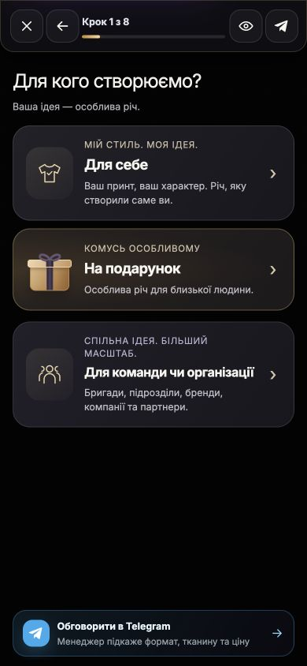

# TwoComms Проверка внешних аудитов и исправления сайта

На 9 октября 2026 года подготовлен локальный пакет исправлений SEO, доступа к публичным сведениям, загрузки ресурсов и аналитики. Подтверждённые дефекты устранены; опубликованный GTM и текущий production использованы как источники проверки. **Этот пакет ещё не развёрнут на production.** Знание бренда моделью, её рекомендации, технический доступ к сайту и фактическая индексация требуют разных доказательств.

Основной checkout содержал посторонние незавершённые изменения и отставал от production. Исправления собраны в отдельном управляемом worktree на production-совместимом коде `27acbf6d42a375fd556bf5642d8696e2144ebe18`. Существующая работа в основном checkout сохранена. Последующие сторонние изменения `main` должны быть учтены перед публикацией.

## Что показывают три аудита

| Источник | Что подтверждено | Что нельзя заключить |
| --- | --- | --- |
| Top Marketing AI Visibility от 09.10.2026, 2 страницы | В четырёх ответах о бренде три модели дали описание, Claude сообщил об отсутствии достоверных сведений. В восьми ответах на два покупательских вопроса бренд рекомендован дважды. | 75 и 25 баллов не измеряют весь рынок. Не приведены версии моделей, полные промпты, настройки веб-поиска, географии и повторные прогоны. Ноль Claude не доказывает блокировку сайта. |
| DontWorry Consolidated Report от 10.09.2026, 9 страниц | Проверены только главная, каталог и контакты. 72 проверки, 68 оценённых, 4 неопределённых; общая оценка 92, отдельный старый PageSpeed около 59. Есть полезные вопросы о загрузке ресурсов и HTML. | Это сентябрьский снимок. Ошибки получения H1/favicon не доказывают отсутствие элементов. Процент lazy loading и число предупреждений валидатора не равны качеству сайта. |
| [Locomotive](https://offer.locomotive.ua/seo/twocomms-shop) | Предложены семантика, улучшение контента и структуры. На трёх изображениях Serpstat есть историческая видимость и позиции в первой десятке. | Утверждения о полном отсутствии метаданных, текстов, внутренних ссылок, фильтров и schema не соответствуют текущему сайту. Нет воспроизводимого экспорта проблемных URL, ссылочного профиля или текущих конверсий. Коммерческие обещания не являются результатом проверки. |

Подробная таблица отдельных утверждений и контекста скриншотов: [сопоставление аудитов](evidence/2026-10-09/audit-claim-reconciliation.md).

## Claude и обнаружение бренда

Публичные robots, llms, sitemap и страницы бренда/услуги отвечали 200 при последовательных запросах. Три запроса с именами ClaudeBot, Claude-SearchBot и Claude-User также получили 200. Правила robots уже разрешали публичные страницы этим агентам; закрытые account/admin/API-маршруты сохранены. HTML содержит индексируемые метаданные, canonical и разбираемые JSON-LD.

Это проверка с нашего адреса и подставленным User-Agent. Она не устанавливает, что реальный адрес Anthropic проходит защиту хостинга, что Anthropic проиндексировала страницы или что конкретный ответ API использовал веб-поиск.

Контрольный веб-поиск 9 октября вернул [Custom Print](https://twocomms.shop/custom-print/), [английскую главную](https://twocomms.shop/en/), каталог на трёх языках, страницы бренда и внешние материалы Министерства/ветеранского фонда. Это подтверждает обнаружимость этих страниц данным поисковым инструментом; оно не измеряет долю рекомендаций Claude или полное покрытие Google. Поисковый снимок Custom Print ещё содержит старые цены и обещания, поэтому после публикации потребуется обновление индекса.

По [документации Anthropic](https://support.claude.com/en/articles/8896518-does-anthropic-crawl-data-from-the-web-and-how-can-site-owners-block-the-crawler), ClaudeBot собирает данные для обучения, Claude-SearchBot обслуживает поиск, Claude-User получает страницы по запросу пользователя. В [API веб-поиск подключается инструментом](https://platform.claude.com/docs/en/agents-and-tools/tool-use/web-search-tool). Поэтому наиболее обоснованный вывод о нуле в PDF: в данном ответе модель не использовала достоверные сведения о бренде; точная причина без параметров прогона неизвестна.

Исправлены реальные недостатки публичного контекста:

- В компактный и полный llms добавлены проверенные сведения об Артеме Синіло, харьковском происхождении и [материал Министерства по делам ветеранов](https://mva.gov.ua/prescenter/category/86-novini/tse-ne-krapka-tse-prodovzhennya-istoriya-artema-sinila-ta-harkivskogo-brendu-twocomms). Факты имеют владельца и источник в реестре; год основания, адрес магазина и часы работы не придуманы.
- Компактный файл ссылается на полный. Основные discovery URL стабильно ведут на украинскую версию независимо от языка запроса; файлы получают согласованное кеширование.
- Уточнено, что одобрение отзыва модератором и подтверждённая покупка различаются. Утверждение «все рейтинги от проверенных покупателей» не соответствовало коду.
- Service использует адрес текущей языковой версии и общий идентификатор организации. У Custom Print один доступный H1 вне скрытых мобильных/десктопных вариантов; видимые заголовки сохранили оформление.

llms остаётся вспомогательным описанием. [Google](https://developers.google.com/search/docs/appearance/ai-features) не требует специального AI-файла или специальной разметки для своих AI-функций. Эти изменения повышают точность доступного контекста, но не гарантируют рекомендации или новую обученную память Claude.

## Исправления аналитики

Текущий опубликованный контейнер `GTM-PRLLBF9H` содержит Google tag `G-109EFTWM05`, Clarity `t7u94cvpqc`, четыре GA4-события `view_item`, `add_to_cart`, `begin_checkout`, `purchase` и рекламные теги. Одновременно собственный loader добавлял ещё один Google script/config/page_view и второй Clarity. Два разных gtag URL подтверждены и в работающем браузере.

| Дефект | Исправленное поведение |
| --- | --- |
| Повторное подключение одинаковых GA4/Clarity | Для точно совпадающих destination ID владельцем является GTM. Страница без такого владельца сохраняет отдельную загрузку. |
| GTM зависел от взаимодействия или ожидания 25–35 секунд | Небольшой startup запускает GTM после разбора документа, полный loader через секунду; платный переход и взаимодействие ускоряют оба. Пассивные органические посещения больше не исключаются ради оценки аудита. |
| Однократный сбой загрузки навсегда отключал startup | Ошибка запроса допускает один повтор. Медленный выполняющийся запрос не дублируется. Повторный вызов не добавляет второй экземпляр. |
| Окончательная ошибка GTM оставляла canonical ecommerce только в очереди | Настраивается отдельная GA4 и передаются ожидавшие и последующие ecommerce-события с исходными `event_id`, items/value/currency и точным `send_to`. Очередь и семантика её push сохраняются; дедупликация ограничена 256 идентификаторами. При восстановленном GTM relay прекращает прямую отправку. |
| `view_item_list` и `select_item` не имели действующих GA4-тегов GTM | Эти два события дополнительно передаются напрямую в GA4, сохраняя общий объект для GTM. Маркер исключает повтор в режиме восстановления; четыре события checkout не получают дополнительного прямого дубля. |
| Клик по избранному/цвету считался выбором товара | `select_item` отправляется по ссылке товара внутри карточки. |
| Раннее Meta-событие исчезало при отсутствии fbq | Сохраняется до SDK, включая исходный ID и тип `trackCustom`. Уже работающая inline-очередь Meta принимает ранние события сразу. |
| Повторное исполнение loader сбрасывало готовность SDK | Добавлена защита повторной инициализации после проверки согласия. |
| Сбой передачи Meta/TikTok удалял события | События остаются до следующей возможности передачи, сохраняя идентификатор для browser/server дедупликации. |
| TikTok каждые 100 мс проверял функцию по ненадёжному признаку | Используется очередь SDK и однократная передача после bootstrap; цикл опроса удалён. |
| Переменная debug отсутствовала в контексте и не отключала живые теги | Добавлен явный серверный `analytics_enabled`, включая отдельный IG checkout. DEBUG-визиты не подключают живые SDK. |

Сохранены существующие рекламные теги GTM, CAPI, правила согласия отдельного IG checkout, inline Meta PageView, paid-landing и органическая политика TikTok для слабых устройств. Покупки и финансовые операции на production для проверки не создавались. Блокировщик или внешняя недоступность провайдера по-прежнему может не допустить отправку; очередь не является подтверждением приёма события рекламной системой.

## Производительность и содержимое

Предварительная загрузка модулей раньше указывала на fingerprinted-файлы, тогда как ESM imports использовали другие адреса. У product-media дополнительно различалась версия query string. Теперь URL preload совпадает с реально импортируемым модулем, включая параметры.

Первые две карточки главной были eager, хотя в браузере находились примерно на 1800–2000 пикселей ниже начала страницы. Все карточки этого блока стали lazy, обновлён ключ кеша фрагмента. Hero и логотипы сохранены eager; общий каталог не получил слепого перевода всех изображений в lazy.

В кнопках шапки, избранного и сворачивания категорий заменены недопустимые div на span с прежними классами. Размеры и обработчики сохранились; avatar-wrapper явно сохраняет display:block. Удалён устаревший content-language pragma; язык документа и hreflang сохранены.

Старые обещания Custom Print не совпадали с текущим калькулятором: фиксированные 350/500 грн, скидка от 10 при других ступенях, гарантированные сроки/курьер, плотности неподтверждённых материалов, 30+ стирок и бесплатная фотосессия. Переработаны девять ответов FAQ и поясняющий текст: отдельно объясняются изделие с принтом и собственная одежда, предварительный расчёт, проверка файла/материала и подтверждение менеджером. Сохранены сценарии подарка, команды, организации, бригады и партнёров. Новые строки переведены на русский и английский: 32 пары, PO/MO согласованы. Остальные существующие пробелы перевода интерфейса требуют отдельного завершения.

Общий purge CSS, удаление Bootstrap/аналитики и минификация ради суффикса `.min` не применялись: текущий собранный CSS уже минифицирован, а первоначально неиспользуемые правила нужны открываемым меню и другим состояниям. Действующая CSP находится в report-only режиме. Полное enforcing CSP требует проверки платёжных и внешних интеграций и не включалось ради зелёного пункта отчёта.

## Проверка

- **74 Django-проверки прошли**: аналитика и Meta config, изображения/markup/preload, discovery и реестр фактов, новая публичная копия, отключение debug tracking. Shared runtime CPython 3.14.6 / Django 6.1. [Лог](evidence/2026-10-09/django-acceptance.txt).
- **31 JS-проверка прошла**: реальное исполнение loader/startup/list handlers в изолированной VM без внешних conversion-запросов; ранние события, согласие, повторное выполнение, ошибки загрузки, GTM fallback и дедупликация. [Лог](evidence/2026-10-09/js-acceptance.txt).
- JS syntax и `git diff --check` прошли. Новый код просмотрен отдельным агентом; найденный им ранний Meta-bounce исправлен и покрыт тестом.
- Локальный Django с отдельной SQLite и искусственным каталогом: мобильный viewport 390×844 и десктоп 1440×1000, корзина открывается, mobile studio запускается, span-иконки/аватар имеют прежние размеры 36×36, горизонтального переполнения нет. UA/RU/EN исправленные тексты и H1 проверены браузером; console errors на проверенных страницах отсутствовали. Это проверка локального интерфейса, не production QA или платёжный E2E.
- Расширенные старые suites не полностью зелёные: **158 тестов / 14 ошибок assertions** и **60 тестов / 5 errors** воспроизведены также на неизменённом baseline. В основном устаревшие строки/тип Organization/варианты конфигуратора, четыре COD-fixtures для запрещённого COD, один IG-fixture с чужим episode deal. [SEO baseline](evidence/2026-10-09/preexisting-seo-test-failures.txt), [analytics baseline](evidence/2026-10-09/preexisting-analytics-test-errors.txt). Их совпадение исключает новую регрессию в этих случаях, но не делает полный проект зелёным и не заменяет обновление fixtures.

## Оставшиеся условия и следующий выпуск

1. Разрешение на публикацию этого конкретного пакета: scoped commit в main, SSH pull по AGENTS.md, collectstatic/compress и штатный restart. До этого production продолжает обслуживать прежний код.
2. После выпуска проверить фактически загруженные версии, один Google/Clarity loader, GA4/Meta/TikTok получение событий и реальные storefront-сценарии. Успешный HTTP или offline VM не доказывает регистрацию provider-side conversion.
3. Проверить реальную индексацию и запросы в Search Console, Bing Webmaster и полноценном повторяемом Claude-прогоне с/без web search; нужны доступ/конфигурация, которых PDF не содержит.
4. Измерить production LCP/CLS/INP и серверную устойчивость отдельно. Последовательные GET были быстрыми, но не доказывают отсутствие 503 при нагрузке и не заменяют field data. Новый сопоставимый mobile Lighthouse после выпуска может учитывать больше честно работающей аналитики; оценку 100 не обещаем.
5. Завершить неподтверждённые условия услуг только с владельцем факта, оставшиеся UI-переводы и старые fixtures. Развитие поисковых посадочных страниц и внешних упоминаний требует реального спроса/ассортимента; массовые однотипные страницы и покупка ссылок ради веса не являются техническим исправлением.

## Браузерная проверка

